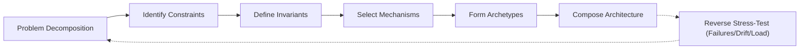

# Chapter 4. A Taxonomy of Computational Problem Domains

## 4.1. The Limits of Reference Architectures

A pervasive failure mode in system design education and engineering practice is the reliance on product-specific reference architectures. When asked to design a high-throughput video platform, engineers reach for "the YouTube architecture"; when tasked with real-time location tracking, they describe "the Uber architecture." 

This heuristic approach fails under real-world conditions for three fundamental reasons:

1. **Superficial Feature Equivalence Over Structural Invariants:** Two systems sharing high-level functional requirements (e.g., streaming video) may operate under irreconcilable physical constraints. A private corporate compliance archive requires strict immutability, synchronous audit trails, and deterministic legal retention, whereas a consumer video streaming platform optimizes for global edge cache hit ratios, progressive degradation, and eventual consistency of view counters. Mimicking the consumer platform's architecture produces an irrecoverable compliance failure.
2. **Conflation of Scale with Mechanism:** Reference architectures typically depict mature, multi-billion-dollar systems composed of hundreds of bespoke internal subsystems (e.g., Google Colossus, Borg, Spanner). Adopting these patterns in an emerging system introduces crushing operational complexity without solving the governing computational bottleneck.
3. **Absence of Reverse Failure Reasoning:** A static block diagram shows component connectivity under nominal conditions. It provides no reasoning mechanism to explain what happens when a cross-datacenter link experiences an asymmetric partition, when a garbage collection pause exceeds a lease timeout, or when upstream producers double their ingestion rate while downstream databases experience compaction stalls.

To develop transferable engineering judgment, system design must be approached not as the cataloging of known systems, but as the systematic decomposition of computational problems from first principles:

$$\text{Problem} \longrightarrow \text{Principles} \longrightarrow \text{Constraints} \longrightarrow \text{Invariants} \longrightarrow \text{Mechanisms} \longrightarrow \text{Archetypes} \longrightarrow \text{Composition} \longrightarrow \text{Validation}$$

---

## 4.2. The Six-Tier Architectural Abstraction Hierarchy

To avoid conflating high-level problem statements with concrete technology choices, we establish a formal six-tier abstraction hierarchy:

| Tier | Abstraction Level | Primary Architectural Concern | Canonical Primitives & Examples |
| :--- | :--- | :--- | :--- |
| **Tier 1** | **Computational Problem Domains (The 7 Roots)** | Fundamental physical, algorithmic, and operational tensions in computer systems. | Storage & Organization, Movement & Transformation, State & Coordination, Execution & Resources, Communication, Retrieval & Discovery, Computation. |
| **Tier 2** | **Problem Signatures & Workloads** | Quantitative traffic profile, read/write asymmetry, and access locality. | Read-heavy (>95% reads), write-heavy append logs, high concurrency, strict latency budgets (<10ms), batch windowing. |
| **Tier 3** | **Physical Constraints & Invariants** | Non-negotiable correctness guarantees and governing physical bounds. | Durability (WAL fsync barrier), Linearizability, Mutual Exclusion (Fencing), Acyclicity, Little's Law, CAP / PACELC. |
| **Tier 4** | **Architectural Mechanisms & Data Structures** | Algorithmic building blocks that mathematically preserve invariants. | LSM-Trees, B+ Trees, SSTables, Raft Consensus, Leases with Fencing Tokens, S2/H3 Cells, Inverted Indexes, CSR Arrays. |
| **Tier 5** | **Architectural Archetypes (The 14 Structures)** | Recurring subsystem structures packaging mechanisms to guarantee invariants under load. | Large Object Storage, High-Write Ingestion, Contended Allocation, Geospatial Routing, Durable Workflows, Search & Retrieval. |
| **Tier 6** | **Composite Industrial Systems** | Production multi-archetype architectures composing across domains. | Ride-Hailing Platform (Uber), Video Publishing & Streaming (YouTube), Real-Time Collaborative Workspace (Google Docs). |

### Tier 1: Computational Problem Domains (The Seven Roots)
The root domains represent the fundamental physical and mathematical tensions in computing:
- **Domain I: Data Storage & Organization** — The preservation, organization, and retrieval of persistent bytes across physical media hierarchies.
- **Domain II: Data Movement & Transformation** — The decoupling, transport, buffering, transformation, and temporal aggregation of data in motion.
- **Domain III: State, Consistency & Coordination** — The management of shared mutable state, concurrency control, distributed consensus, and exclusivity under partial failure.
- **Domain IV: Execution & Resource Management** — The scheduling, placement, lifecycle orchestration, and durable execution of computational workloads across finite infrastructure.
- **Domain V: Communication & Interaction** — The physical protocols, session semantics, multiplexing, and bidirectional exchange of information between distributed entities.
- **Domain VI: Information Retrieval & Discovery** — The extraction of relevant records from high-cardinality multi-dimensional candidate spaces (text, vectors, spatial coordinates, graphs).
- **Domain VII: Computation & Optimization** — The parallelization, partitioning, and distributed execution of data-intensive and compute-intensive algorithmic transformations.

### Tier 2: Problem Signatures & Workload Characteristics
A problem signature isolates the quantitative and operational profile of a system before technology selection:
- **Read/Write Skew:** Write-heavy ($>70\%$ writes, append-dominated), Read-heavy ($>95\%$ reads, cacheable), or Balanced transactional.
- **Access Locality:** Temporal (recently created items accessed frequently), Spatial (adjacent items accessed together), or Random uniform.
- **Latency Tolerances:** Sub-millisecond (in-memory lookup), Interactive ($10\text{--}100\text{ ms}$), Near-real-time ($1\text{--}10\text{ s}$), or Asynchronous batch (minutes to hours).
- **State Cardinality & Working Set:** Whether the active working set fits in single-node DRAM, cluster DRAM, NVMe SSD, or cold object tiers.

### Tier 3: Physical Constraints & Correctness Invariants
The immutable boundaries of physics and mathematical logic that govern system behavior:
- **Physical Bounds:** Speed of light in fiber ($\approx 5\text{ µs/km}$), memory bus bandwidth ($\approx 50\text{--}100\text{ GB/s}$), NVMe random I/O latency ($\approx 10\text{--}50\text{ µs}$), network packet serialization delay.
- **Governing Theorems:** CAP Theorem (Brewer), PACELC (Abadi), Little's Law ($L = \lambda W$), Amdahl's Law, Universal Scalability Law (Gunther).
- **Correctness Invariants:** Properties that must never be violated under any failure mode:
  - *Durability:* Committed writes survive node, power, or disk failure.
  - *Linearizability:* Operations appear to execute atomically at a specific point in time between invocation and response.
  - *Mutual Exclusion:* No two concurrent processes hold exclusive ownership of a resource simultaneously.
  - *Acyclicity:* Hierarchical namespace movements or execution task dependencies never form directed cycles.

### Tier 4: Architectural Mechanisms & Data Structures
The atomic algorithmic and data-structure building blocks used to preserve invariants:
- *Storage:* Log-Structured Merge-trees (LSM), B+ Trees, Write-Ahead Logs (WAL), SSTables, Bloom filters.
- *Coordination:* Paxos, Raft, Fencing Tokens, Leases, Vector Clocks, Compare-And-Swap (CAS), Multi-Version Concurrency Control (MVCC).
- *Indexing:* Inverted indexes, Roaring Bitmaps, S2 Hilbert curves, H3 hexagonal hierarchies, HNSW vector graphs, Compressed Sparse Row (CSR) arrays.
- *Movement:* Partitioned commit logs, Consumer groups, Sliding/Tumbling window watermarks, Transactional Outbox.

### Tier 5: Architectural Archetypes
A recurring architectural structure that packages mechanisms to guarantee invariants under stated constraints. An archetype is not a whole application; it is a recognizable subsystem architecture (e.g., *Archetype II: High-Write Ingestion & Logs*; *Archetype IV: Contended Resource Allocation*).

### Tier 6: Composite Industrial Systems
A complete product architecture realized by composing multiple archetypes across different domains (e.g., A ride-hailing backend composed of Archetype IX Geospatial Discovery + Archetype IV Contended Driver Allocation + Archetype II Location Ingestion + Archetype VIII Real-Time Trip Sync).

---

## 4.3. Criteria for a Valid Problem Domain

To qualify as a root problem domain in this taxonomy, a candidate category must satisfy four strict admission criteria:

1. **Orthogonal Physical or Mathematical Governing Principle:** The domain must address an inherent physical tension (e.g., bandwidth vs. latency, durability vs. write amplification, safety vs. liveness) rather than a business application category.
2. **Distinct Invariant Space:** Violations of correctness in the domain must be described by invariants unique to that domain (e.g., *loss of linearizability* in Domain III vs. *loss of recall* in Domain VI vs. *straggler skew* in Domain VII).
3. **Mechanism Non-Prescriptiveness:** The domain must encompass multiple competing mechanisms and data structures without prescribing any single technology.
4. **Composability:** The domain must compose cleanly with other domains without creating circular architectural dependencies.

---

## 4.4. The Forward Derivation & Reverse Validation Cycle

System design is not a linear waterfall; it is a bidirectional reasoning process:

### The Forward Pass: Derivation
1. **Deconstruct Requirements:** Strip domain-specific nouns (e.g., "users", "tweets", "rides") and extract computational primitives (e.g., high-write ingestion, fan-out distribution, contested allocation).
2. **Derive Invariants from Constraints:** What must *never* happen? (e.g., "Two users must never book the same seat", "No committed event may be lost if two out of three storage nodes crash").
3. **Select Minimal Mechanisms:** Choose data structures and protocols that mathematically guarantee the invariants with the lowest operational overhead.
4. **Compose Archetypes:** Assemble the archetypes along clearly defined consistency and network boundaries.

### The Reverse Pass: Validation Under Adversity
Once an architecture is drafted, it must be systematically audited in reverse by injecting realistic adverse conditions:
1. **Asymmetric Network Partitions:** Can node A talk to B, but not C? Does split-brain occur?
2. **Clock Drift and NTP Jumps:** Does the system rely on physical timestamps for correctness? If a clock jumps backward $250\text{ ms}$, are events duplicated or deleted?
3. **Garbage Collection / Process Pauses:** If a thread pauses for 10 seconds during full GC, does its lease expire while it still believes it is the active leader? Are destination writes protected by monotonic fencing tokens?
4. **Cascading Backpressure Stalls:** If a downstream database begins a major compaction cycle, does pressure propagate upstream gracefully via bounded queues, or does memory balloon until out-of-memory (OOM) crashes ripple through the cluster?
